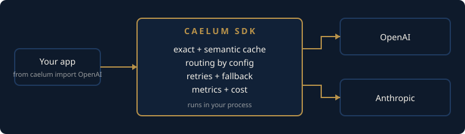

# CAELUM

**The control plane for AI inference.**

[](https://github.com/kanazoeissouf83-ops/caelum/actions/workflows/ci-python.yml)
[](https://pypi.org/project/caelum-ai/)
[](packages/python/pyproject.toml)
[](packages/python/pyproject.toml)
[](LICENSE)

> **Status: 0.1.0 — first public release.** The API may still change before 1.0.



CAELUM is a drop-in layer between your application and LLM providers. Change one import and
get caching, routing, retries, fallback and cost metrics. You keep your code, your types and
your own provider API keys.

## Quick install

```bash
pip install "caelum-ai[openai]"      # or [anthropic], [gemini], [mistral]
```

```python
from caelum import OpenAI            # instead of: from openai import OpenAI

client = OpenAI(cache=True, retry=True)   # reads OPENAI_API_KEY, like the OpenAI SDK
resp = client.chat.completions.create(
    model="gpt-4o-mini",
    messages=[{"role": "user", "content": "Hello"}],
)
client.metrics.print_summary()       # requests, cache hits, cost saved/spent, latency
```

The package is `caelum-ai`; you import it as `caelum`.

## Why CAELUM

- **Drop-in.** Same arguments, methods, objects and static types as the official SDKs.
- **Local-first.** The cache and metrics live on your machine. Nothing is sent to CAELUM.
- **Opt-in.** Every feature that can change an answer is off until you enable it.
- **Neutral.** CAELUM never resells tokens and never chooses a provider or model for you.

## Features

| Feature | What it does |
| --- | --- |
| Exact cache | Identical requests are answered from a local SQLite file. |
| Semantic cache | Opt-in: a rephrased question reuses an earlier answer, once a small model confirms both ask the same thing. |
| Routing | Send requests to chosen models from a dict, JSON or YAML config. |
| Fallback | When a provider fails, switch to the model you named on another provider, or to a free local model. |
| Local models | Ollama, llama.cpp, vLLM and LM Studio as free fallback or routing targets. |
| Retries | Opt-in backoff on rate limits and outages. |
| Metrics | `client.metrics`: calls, tokens, cache hits, latency, estimated cost, JSON export. |
| CLI | `caelum cache stats`: what your cache holds and what it is worth. |

Supported providers today: **OpenAI**, **Anthropic**, **Google Gemini** (`from caelum import genai`) and
**Mistral** (`from caelum import Mistral`). Gemini and Mistral get the exact cache, retries and
metrics for now. Local models (Ollama, llama.cpp, vLLM, LM Studio) can serve as free fallback
or routing targets. OpenAI-compatible APIs (OpenRouter, DeepSeek, Groq...) work through
`base_url`; tested through OpenRouter on 16 model families (Mistral, DeepSeek, Llama, Qwen,
Gemma, Grok, Phi, Cohere, Amazon Nova, Kimi, GLM, Nemotron, Granite, MiniMax, Perplexity
Sonar, Solar).

Tested on Windows and Linux, Python 3.10 to 3.14, with real API calls (see
[CHANGELOG](CHANGELOG.md)).

## Measured numbers

From our own benchmarks (`benchmarks/`), not guarantees:

- Exact cache saved **30%** of calls on a workload with 30% repeated requests.
- Overhead on cache misses: **under 1 ms** at p95 (measured +0.25 to +0.56 ms; target: under 5 ms).
- Semantic cache (opt-in) with its verifier: **38 of 50 paraphrases reused, 0 of 50
  look-alike questions answered wrongly** (real OpenAI API test; embeddings alone: 0 of 50).

Your savings depend on how often your prompts repeat.

## How it compares

- **LiteLLM** is a great choice if you want one OpenAI-style API over 100+ providers, usually
  through a proxy server. CAELUM is an in-process library that keeps the official SDK types.
- **OpenRouter** is a hosted marketplace that bills you for tokens. CAELUM never touches your
  billing: you pay your providers directly.

## Getting started

Read the [docs](docs/introduction.mdx): quick start, caching, routing, reliability and
observability.

## Community

- [GitHub Discussions](https://github.com/kanazoeissouf83-ops/caelum/discussions) for questions and ideas
- X (Twitter): [@caelum_ai73q7m](https://x.com/caelum_ai73q7m)
- Contributing: see [CONTRIBUTING.md](CONTRIBUTING.md). Look for `good first issue`.

## Roadmap

- [x] OpenAI and Anthropic wrappers, exact and semantic cache, routing, fallback, metrics
- [ ] First public release on PyPI
- [x] Google Gemini (exact cache, retries, metrics)
- [x] Mistral (exact cache, retries, metrics)
- [ ] Routing and fallback across Gemini and Mistral
- [x] Semantic cache verified by a small model before any reuse
- [x] Local models (Ollama, llama.cpp, vLLM, LM Studio) as fallback and routing targets
- [x] `caelum cache stats` command
- [x] CAELUM Cloud: shared cache across servers, cost per customer, budget alerts ([caelum-ai.com](https://caelum-ai.com/pricing): free up to 10,000 questions a month, Starter $29)
- [x] Automatic exclusions, frequency admission, per-request journal with net savings

## License

Apache 2.0. See [LICENSE](LICENSE). Contributors sign a [CLA](CLA.md). "CAELUM" is a
trademark of Issouf KANAZOE: see the [trademark policy](TRADEMARKS.md).
